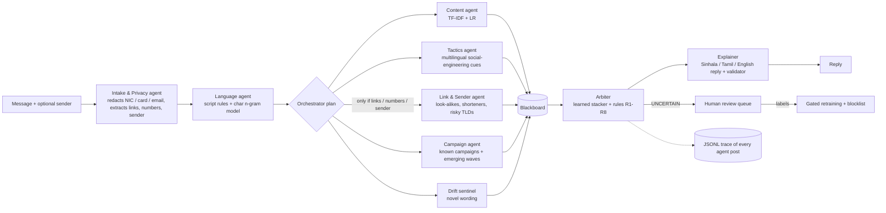

# Rakshaka AI: a multi-agent second opinion on scam messages

**Innodata AI Catalyst 2026 · University Track · Domain: Cybersecurity**
**Team Byte Benders · University of Moratuwa** · Geemal Fernando (lead), Thisuka Mahiru, Chanith Wijekoon, Pamindu Piumaka

Scam SMS and WhatsApp messages reach Sri Lankans every day in Sinhala, Tamil, English and code-mixed
Singlish and Tanglish. Rakshaka AI lets anyone forward a suspicious message and get a verdict
(**SCAM**, **UNCERTAIN** or **LIKELY SAFE**), the reason, and one clear next step, in their own
language. It never says "safe" when it is unsure. Unsure messages go to a human reviewer.

The checker is a **team of specialist agents** on a shared blackboard, coordinated by an orchestrator.
It is benchmarked against a **single-agent baseline** that uses the same data and the same model.



## Quick start

Python 3.12+ on CPU. No GPU, no paid API.

```bash
python -m venv .venv && source .venv/bin/activate        # Windows: .venv\Scripts\activate
pip install -r project/requirements.txt
python project/main.py check "SLKPOST: unpaid customs fee Rs 92. Pay at slpost-lk.top/pay" --sender SLKPOST
```

The first run generates the synthetic data and trains every agent, which takes about 15 seconds.

| Command | What it does |
|---|---|
| `python project/main.py check "<text>" [--sender ID] [--json]` | Check one message and show every agent's output |
| `python project/main.py demo` | `project/samples/input/*.txt` → `project/samples/output/*.json` |
| `python project/main.py benchmark` | Multi-agent vs single-agent → `project/reports/benchmark.{json,md}` |
| `python project/main.py human-sheet` / `human-score FILES` | Balanced 40-message rating page (`rate.html`) and scorer: humans vs both systems |
| `python project/main.py serve --port 8080` | JSON API: `POST /check {"text": "...", "sender": "..."}`, `GET /health` |
| `python project/main.py review` / `label ID scam\|legitimate` | Human review queue and reviewer decisions (scam links go to the blocklist) |
| `python project/main.py retrain` / `rollback` | Gated retraining with reviewed labels; restore previous version |
| `python project/main.py train` | Retrain all learned agents |
| `python -m unittest discover -s tests` | Tests for the agents and the pre-existing pipeline |

Optional: set `ANTHROPIC_API_KEY` to let the Explainer reword replies with an LLM. The verdict never
comes from the LLM. A validator rejects any reworded reply that changes the verdict or cites reasons
no agent found. All reported results were produced **without** an LLM.

## Results so far (Phase 1 MVP, synthetic and small hand-written sets)

Produced by `python project/main.py benchmark`. Full table: [project/reports/benchmark.md](project/reports/benchmark.md).

| Dataset | Scam caught: multi / single | Unsafe misses: multi / single | False alarms: multi / single |
|---|---|---|---|
| Held-out templates (264) | 100% / 93.7% | 0% / 0% | 0% / 0% |
| New tactics, e.g. digital-ID scams (152) | 95.5% / 87.1% | 0% / 0% | 0% / 0% |
| Independent Sinhala/Tanglish set (65) | 80% / 80% | 3.3% / 0% | 0% / 0% |
| Link and sender stress set (64)* | 78.1% / 12.5% | 0% / 3.1% | 0% / 0% |

\*The stress set was written while the link rules were being designed, so it is not an unbiased estimate.
The costs of the multi-agent design: about 9–14 ms per message instead of about 2 ms, and a higher human-review
load on the independent set (41.5% vs 29.2%). The human baseline has not been run yet: the timed rating page and scorer are ready ([docs/HUMAN_BASELINE.md](docs/HUMAN_BASELINE.md)).

## Repository layout

| Path | What it is |
|---|---|
| `project/main.py` | Entry point (CLI and JSON API) |
| `project/rakshaka_agents/` | **New for AI Catalyst:** agents, blackboard, orchestrator, arbiter, explainer, baseline, benchmark |
| `project/samples/`, `project/traces/sample_traces.jsonl` | Input and output samples; execution traces of agent interactions |
| `project/reports/` | Benchmark results and the human-baseline sheet |
| `docs/Proposal.docx`, `docs/Workflow.md`, `docs/PROJECT_DETAILS.md` | Proposal, workflow, technical details and disclosures |
| `docs/PROJECT_PLAN.md`, `docs/SUBMISSION_CHECKLIST.md` | Complete project plan (milestones, risks) and submission checklist |
| `rakshaka/`, `src/`, `app/`, `scripts/` | **Pre-existing Rakshaka AI code (Geveo Ignite 2026), reused and disclosed:** classifier, data generator, FastAPI/Streamlit prototype |
| `docs/LEGACY_README.md` | README of the pre-existing single-model prototype |
| `project-demo.mp4` | Demo video, due with the Phase 1 MVP (29 Nov) |

## Disclosure

This repository was cloned (not forked) from our earlier project
[geemalfernando/Rakshaka_AI](https://github.com/geemalfernando/Rakshaka_AI). That project is a single-model
classifier with drift monitoring, built for Geveo Ignite 2026, and its git history is kept here so that
pre-existing work can be told apart from new work. The multi-agent system in `project/` was built for AI
Catalyst. Third-party libraries, data sources and AI tools are listed in
[docs/PROJECT_DETAILS.md](docs/PROJECT_DETAILS.md).
