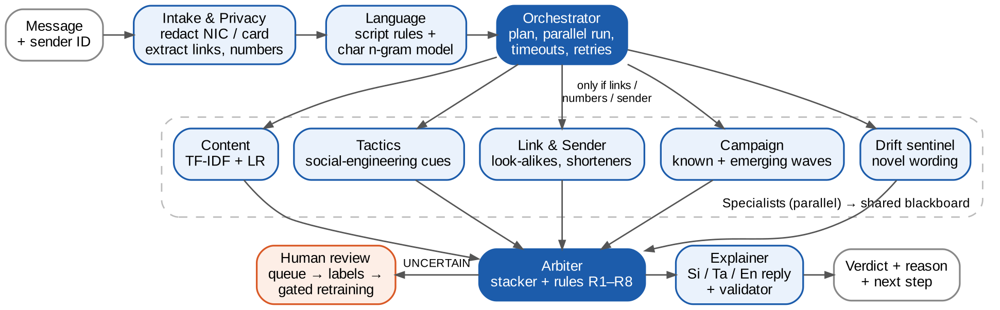

# Complete project plan

Deliverable: architecture, agent design, benchmarking and evaluation plan, milestones and risk analysis.
Due 29 November 2026, 11:59 PM. Team Byte Benders, University of Moratuwa.

## 1. Architecture

| Layer | Component | Code |
|---|---|---|
| Entry | CLI and JSON API (`POST /check`, `GET /health`) | `project/main.py` |
| Coordination | Orchestrator: plan, parallel run, 2 s timeout, 1 retry, fallbacks | `project/rakshaka_agents/orchestrator.py` |
| Shared state | Blackboard of typed `AgentMessage` posts; JSONL traces | `project/rakshaka_agents/blackboard.py` |
| Specialists | Intake, Language, Content, Tactics, Link & Sender, Campaign, Drift | `project/rakshaka_agents/agents.py`, `lexicons.py` |
| Decision | Arbiter (stacker + rules R1–R8), Explainer (templates + validator, optional LLM) | `project/rakshaka_agents/decision.py`, `llm.py` |
| Learning | Review queue, labels, blocklist, gated retraining, rollback, audit log | `project/rakshaka_agents/learning.py` |
| Training | Language, content, campaign index, drift threshold, out-of-fold stacker | `project/rakshaka_agents/training.py` |
| Evaluation | Single-agent baseline, benchmark, failure injection, human sheet | `project/rakshaka_agents/baseline.py`, `benchmark.py` |

## 2. Agent design

See `docs/PROJECT_DETAILS.md` (agent table) and `docs/Workflow.md` (decision rules). These design principles are fixed:

1. **One responsibility per agent**, so any agent can be replaced (for example a transformer Content agent) without touching the others.
2. **Agents talk only through the blackboard.** The orchestrator owns the order, so a new agent is one class plus one line in `plan()`.
3. **Privacy by position.** Only the Intake agent sees raw text.
4. **Fail safe.** A missing or failed agent can make a verdict more cautious, never more permissive (rules R4–R8, F1).
5. **Explain from evidence.** The Explainer can only cite what an agent posted; the validator enforces this.

## 3. Benchmarking and evaluation plan

| Comparison | How | Status |
|---|---|---|
| Multi-agent vs single agent | Same data, model, thresholds and retry budget; 4 datasets; `python project/main.py benchmark` | Done, re-run before submission |
| Robustness | Each agent attempt fails with p = 0.3 and 0.6 | Done |
| Throughput and cost | 1 and 4 workers; USD per 1,000 messages on a USD 24/month server | Done; process workers planned |
| Human baseline | 4 raters × the same 40-message blind sheet, timed; `human-sheet` and `human-score` | Planned 21–24 Nov |
| Per-language quality | English, Sinhala, Singlish, Tamil, Tanglish | Done |
| Learning loop | Label UNCERTAIN messages → retrain → gate decision logged | Working end to end |

Primary metric: **unsafe miss** (a scam called LIKELY SAFE). Secondary: scam caught, false alarm, review load, latency.
Every reported number comes from the code. Test conditions and sample sizes are stated in `project/reports/benchmark.md`.

## 4. Milestones

| Date | Milestone | Owner |
|---|---|---|
| 19 Nov | Multi-agent pipeline, baseline, benchmark, traces, docs | Geemal (lead) |
| 20 Nov | **Proposal submitted** (`docs/Proposal.docx`); repo shared with Innodata | Geemal |
| 21–24 Nov | Human baseline collected; native-speaker review of Sinhala/Tamil replies and cue lists | Thisuka, Chanith |
| 21–24 Nov | Language agent: more Singlish/Tanglish data; Tactics agent: missing cues found in testing (gift cards, "danna puluwanda") | Team |
| 25–27 Nov | Review desk UI (adapt the existing Streamlit admin desk to `learning.py`); process-pool workers; WhatsApp webhook prototype | Team |
| 28 Nov | Final benchmark run; record `project-demo.mp4` (5–10 min, H.264/AAC, ≤100 MB) | Team |
| **29 Nov** | **MVP + complete project plan submitted** | Team |
| 7 Dec | Grand finale: final-day features added as new agents/tools; 10-slide, 15-minute demo | Team |

## 5. Risk analysis

| Risk | Likelihood | Impact | Mitigation | Owner |
|---|---|---|---|---|
| Synthetic data overstates accuracy | High | High | State it on every result; independent hand-written set; seek consented real reports | Team |
| Unsafe miss on new scam wording | Medium | High | Rules R4–R7; drift sentinel; review loop; unsafe miss is the primary metric | Team |
| Wrong reply language (Singlish → Tanglish) | Medium | Medium | More Singlish data; fall back to a bilingual reply when language confidence is low | Team |
| Sinhala/Tamil wording errors | Medium | Medium | Native-speaker review before demo | Thisuka, Chanith |
| Throughput falls under threads (GIL) | High | Low (demo) / Medium (scale) | Process-pool workers; stateless agents scale horizontally | Geemal |
| Final-day feature needs unplanned capability | Medium | High | Blackboard design: add an agent without changing others; rehearse adding one agent in under 1 hour | Team |
| Live demo failure | Low | High | CPU-only, offline-capable; recorded demo video as a backup; `demo` command | Team |
| Secrets or private data leaked in repo | Low | High | No secrets needed; `.gitignore` covers runtime and models; redacted traces only | Geemal |
| Originality question (pre-existing code) | Medium | High | Clear disclosure; kept git history; new work isolated in `project/` | Geemal |
