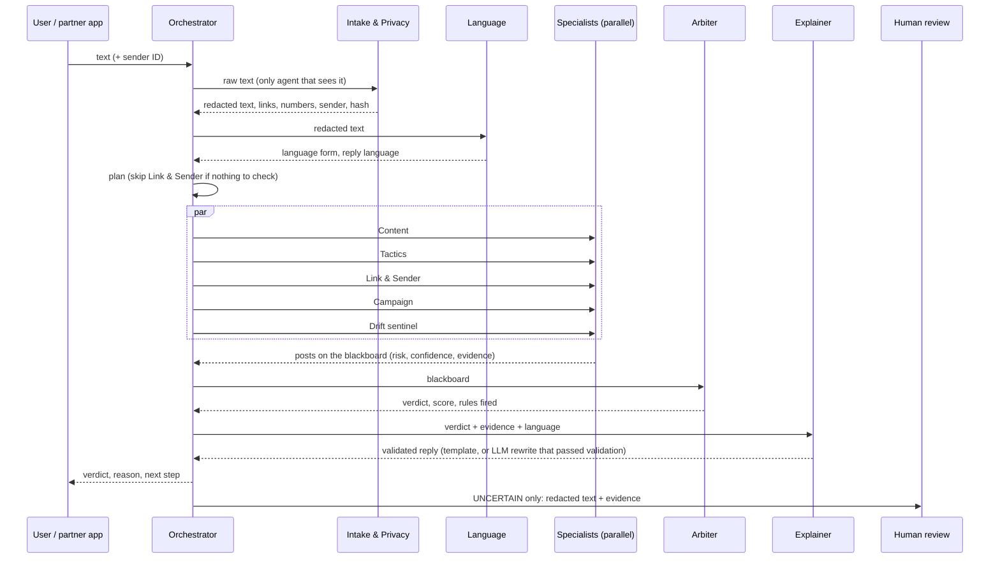
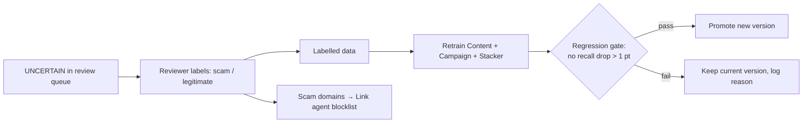

# Workflow

## 1. Runtime flow for one message

| Step | Agent | Input | Output | Failure handling |
|---|---|---|---|---|
| 1 | Intake & Privacy | raw text, sender | redacted text, links, phone numbers, sender, SHA-256 | empty input → ERROR, nothing else runs |
| 2 | Language | redacted text | english / sinhala / singlish / tamil / tanglish, reply language | on failure, reply in English |
| 3 | Orchestrator (plan) | intake output | list of specialists to run | — |
| 4 | Content, Tactics, Link & Sender, Campaign, Drift (parallel) | redacted text, intake data | risk 0–1, confidence, evidence | 2 s timeout, 1 retry, then marked `error`; the arbiter treats it as missing |
| 5 | Arbiter | all posts | SCAM / UNCERTAIN / LIKELY_SAFE, score, rules | arbiter failure → UNCERTAIN (rule F1) |
| 6 | Explainer | verdict, evidence, language | reply in the user's language | validator rejects bad LLM output → template; explainer failure → fixed safe reply |
| 7 | Review queue | UNCERTAIN results | redacted text + evidence for a reviewer | — |
| 8 | Trace | everything | one JSONL line per message | — |

## 2. Decision policy (Arbiter)

1. A logistic-regression **stacker** combines Content, Tactics and Campaign risk and the novelty ratio. It is trained
   on out-of-fold outputs, so it learns how far to trust each agent on wording it has not seen.
2. Policy rules then resolve conflicts:

| Rule | Condition | Effect |
|---|---|---|
| R1 | Credential or payment request **and** a link or number to act on | score ≥ 0.90 |
| R2 | Look-alike, blocklisted or brand-in-unofficial domain, or look-alike sender | score ≥ 0.85 |
| R3 | The only link is an official domain and there is no action request | score ≤ 0.50 |
| R4 | Would be LIKELY_SAFE, but a specialist says ≥ 0.7 | UNCERTAIN |
| R5 | Would be LIKELY_SAFE, but the wording is novel (drift) | UNCERTAIN |
| R6 | Would be LIKELY_SAFE, but the Content agent failed | UNCERTAIN |
| R7 | Would be LIKELY_SAFE, but the message is part of an emerging wave | UNCERTAIN |
| R8 | A learned specialist failed and only the stacker says SCAM | UNCERTAIN (degraded mode) |

Thresholds: score ≥ 0.70 → SCAM, ≤ 0.30 → LIKELY_SAFE, otherwise UNCERTAIN.

## 3. Learning loop (human in the loop)

Built: `python project/main.py review` lists the queue, `label ID scam|legitimate` records a decision (and adds
non-official link domains of scams to the blocklist at once), `retrain` trains a candidate into `project/models_candidate/`
and promotes it only if `rakshaka/modeling.py::retrain_gate` (pre-existing) passes on val + test, and `rollback`
restores the previous version. Every step is written to `project/runtime/model_audit.jsonl`.

## 4. Build and evaluation steps

| # | Step | Command | Output |
|---|---|---|---|
| 1 | Generate synthetic data (seed 42, split by template) | `python src/make_data.py` (automatic on first run) | `data/*.csv` |
| 2 | Train agents | `python project/main.py train` | `project/models/agents.joblib`, `meta.json` |
| 3 | Run samples | `python project/main.py demo` | `project/samples/output/*.json`, traces |
| 4 | Benchmark | `python project/main.py benchmark` | `project/reports/benchmark.{json,md}` |
| 5 | Human baseline | `python project/main.py human-sheet`, then raters fill it, then `human-score` | human scores on the same messages |
| 6 | Tests | `python -m unittest discover -s tests` | pass / fail |

## 5. Implementation plan

| Window | Deliverable |
|---|---|
| 16–20 Nov | Agents, orchestrator, arbiter, explainer, baseline, benchmark harness, review → retrain → rollback loop, CI (done); proposal |
| 21–24 Nov | Human baseline (4 raters × 40 messages, timed); native-speaker review of Sinhala/Tamil replies and cue lists; more Singlish/Tanglish language data |
| 25–27 Nov | Review-queue labelling UI on the existing Streamlit desk; process-pool workers for throughput |
| 28–29 Nov | Final benchmark run, demo video (`project-demo.mp4`), documentation |
| 7 Dec | Final-day features from Innodata, added as new agents or tools on the same blackboard |
